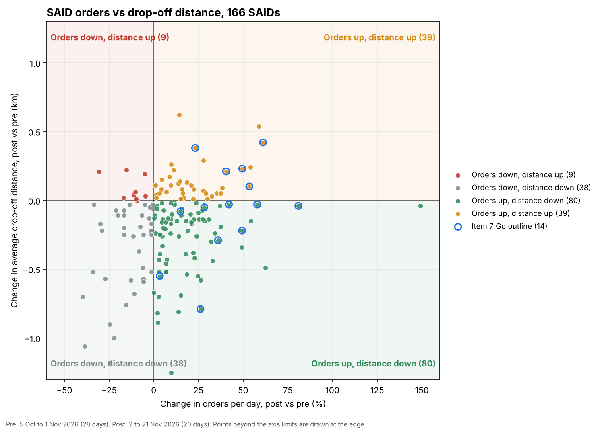

# SAID orders vs drop-off distance (pre vs post)

Each dot is one SAID with at least 50 completed orders in both periods (166 SAIDs). The horizontal axis is the change in orders per day, and the vertical axis is the change in average drop-off distance, both post vs pre.

- **Pre:** 5 Oct to 1 Nov 2026 (28 days). **Post:** 2 to 21 Nov 2026 (20 days).
- Orders are compared per day, because the two periods have different lengths.
- Drop-off distance is the average Google drop-off distance in km, from completed orders.
- Dots beyond the axis limits are drawn at the edge. Three SAIDs are affected: 855625 (+149%), 740773 (+0.54 km) and 908738 (+0.42 km) are clipped at the edge of their axes.

## Quadrants

| Quadrant | SAIDs | Meaning |
|---|---|---|
| Orders up, distance down | 80 | Best outcome: more orders and shorter trips. |
| Orders up, distance up | 39 | Growth came with longer trips. |
| Orders down, distance down | 38 | Fewer orders, but shorter trips. |
| Orders down, distance up | 9 | Worst outcome: fewer orders and longer trips. |

## What stands out

- Most SAIDs (80 of 166) grew orders while their drop-offs got shorter. This is the pattern the overlap-coverage question predicts.
- Of the 14 Item 7 Go SAIDs, 9 are in the "orders up, distance down" quadrant and 5 are in "orders up, distance up". The five with longer trips are all Ibadan SAIDs: 908709, 908712, 908738, 908650 and 911658.
- No Item 7 Go SAID is in either "orders down" quadrant.
- Only 9 SAIDs lost orders and got longer trips. Most of them are Medplus Pharmacy or Chicken Republic SAIDs in Lagos.

## Caveats

- This is a before/after comparison with no control group, so it shows direction, not cause.
- Item 7 Go is shown as one brand. It includes the nine Ibadan SAIDs and five Lagos SAIDs with the same store name, and only the Ibadan ones are the experiment cohort.
- Drop-off distance is a simple average per SAID and doesn't separate overlap orders from the rest. A test of the overlap question needs the per-order check described in the README.

## Source

- Data: `outputs/said_quadrant_all.csv` (BigQuery, project `dhub-glovo`, source tables in `fulfillment-dwh-production.curated_data_shared_glovo`).
- Chart: `analysis/saids_quadrant.png`, rendered with matplotlib from the same CSV.
